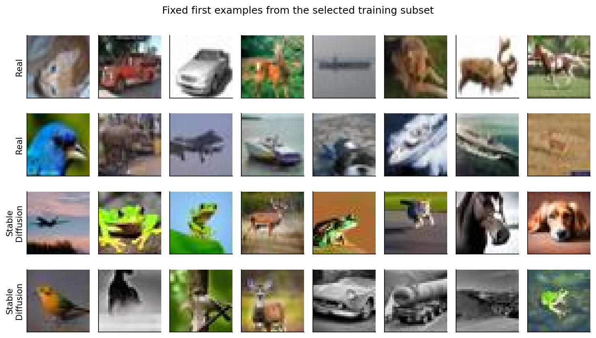
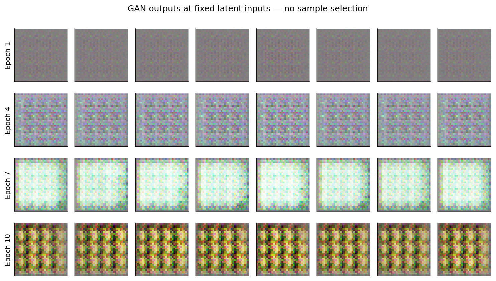
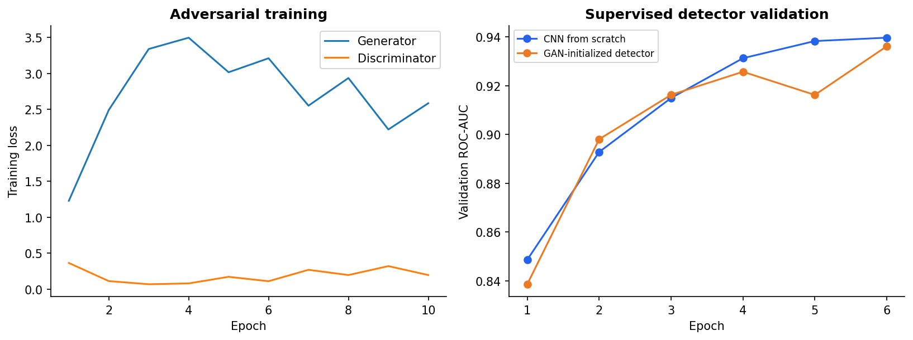
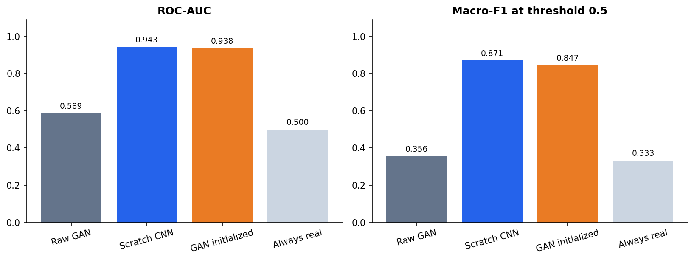
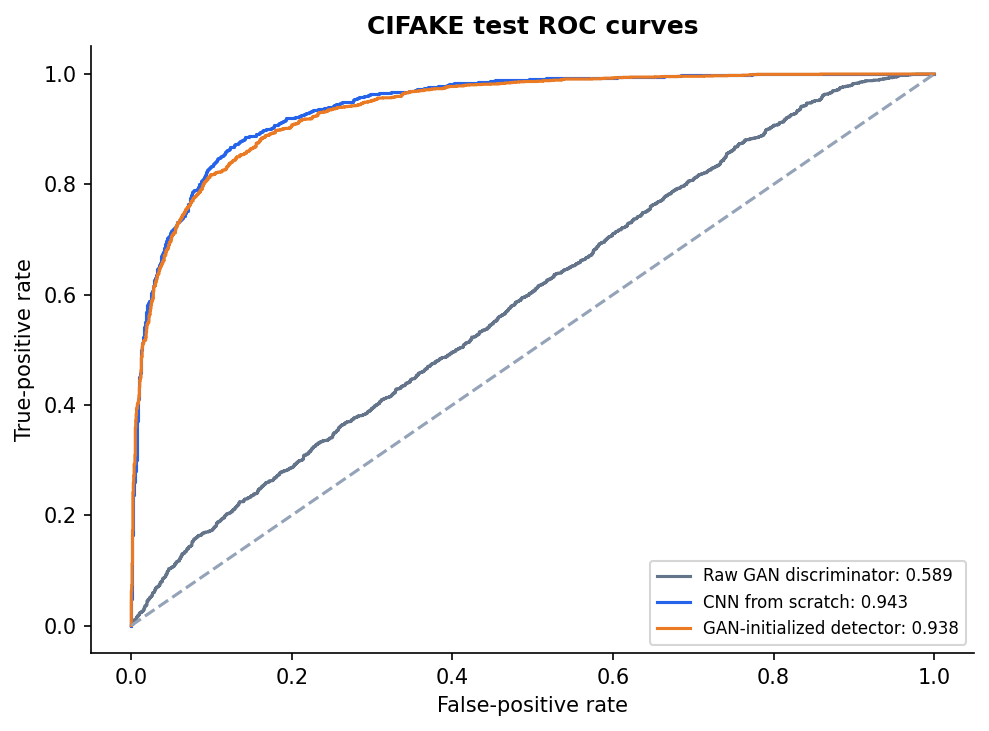
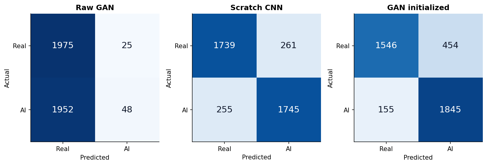
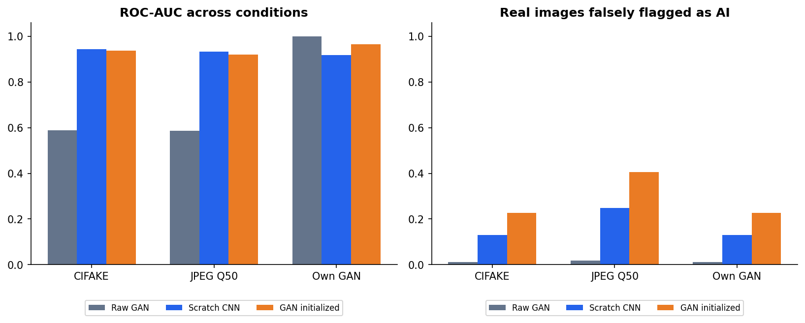
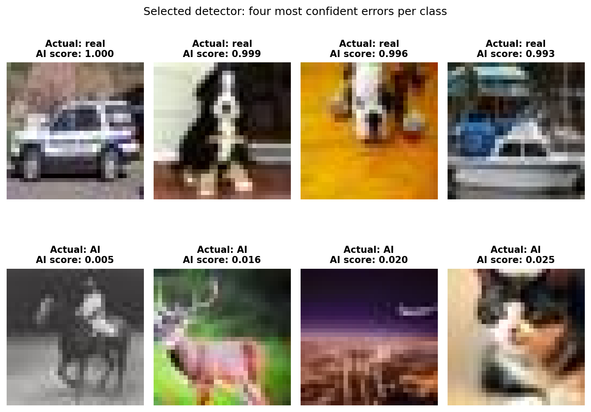

# هل يكتشف مميّز الشبكة التوليدية الصور المصطنعة؟

دراسة انتقال تعلم: تدريب شبكة توليد تنافسية، ثم اختبار ما إذا كان مميّزها يكشف صورًا ناتجة عن أسلوب توليد مختلف.

استخدمت التجربة 18,000 صورة من CIFAKE بدقة 32 × 32 ولون RGB. اختيرت شبكة التفاف من الصفر باستخدام مجموعة التحقق، ثم قُيّمت على 4,000 صورة اختبار متوازنة.

بلغت مساحة منحنى ROC للمميّز الخام 0.999997 تقريبًا على صور مولّده، لكنها هبطت إلى 0.5890 على صور الانتشار. لم تتفوق تهيئة الكاشف بأوزان المميّز على التدريب من الصفر في المقياس الأساسي.

بلغ فرق مساحة ROC بين التهيئة التنافسية والتدريب من الصفر -0.0052، بفاصل تقريبي [-0.0088, -0.0018]. كما اختُبر أثر ضغط JPEG بدرجة جودة 50.

التعرف على آثار مولّد واحد ضعيف لا يثبت القدرة العامة على كشف الصور المصطنعة. النتائج تخص مجموعة واحدة وبذرة تدريب واحدة وميزانية ثابتة، ولا تثبت أداءً عامًا على مولّدات أو صور خارج التجربة.

## النتائج المسجّلة

الأرقام التالية من التنفيذ المحفوظ لهذه النسخة؛ لم تُعَد التجارب أثناء تعريب التوثيق.

### التحقق أثناء التدريب

| النموذج | ROC-AUC للتحقق | حقبة الحفظ المختارة |
| :--- | ---: | ---: |
| مميّز GAN الخام | 0.6000 | 10 |
| شبكة التفاف من الصفر | 0.9397 | 6 |
| كاشف مهيّأ بأوزان GAN | 0.9362 | 6 |
| خط أساس يصنّف الجميع صورًا حقيقية | 0.5000 | N/A |

### التقييم النهائي على الاختبار المحفوظ (4,000 Images)

| النموذج | ROC-AUC | Macro-F1 | الدقة |
| :--- | ---: | ---: | ---: |
| مميّز GAN الخام | 0.5890 | 0.3564 | 50.58% |
| شبكة التفاف من الصفر | 0.9433 | 0.8710 | 87.10% |
| كاشف مهيّأ بأوزان GAN | 0.9381 | 0.8469 | 84.78% |
| خط أساس يصنّف الجميع صورًا حقيقية | 0.5000 | 0.3333 | 50.00% |

### الانتقال بين المولدات واختبار أثر الضغط

| النموذج | ROC-AUC على CIFAKE | ROC-AUC بعد ضغط JPEG Q50 | ROC-AUC على صور المولّد نفسه |
| :--- | ---: | ---: | ---: |
| مميّز GAN الخام | 0.5890 | 0.5858 | 1.0000 |
| شبكة التفاف من الصفر | 0.9433 | 0.9323 | 0.9174 |
| كاشف مهيّأ بأوزان GAN | 0.9381 | 0.9193 | 0.9647 |
| خط أساس يصنّف الجميع صورًا حقيقية | 0.5000 | 0.5000 | 0.5000 |

## الرسوم والنتائج المرئية

الرسوم محفوظة من التنفيذ الأصلي. تعريب هذه الصفحة لا يغيّر بياناتها أو تسميات الصور داخل الملفات.

## الملفات المرجعية

- [مقاييس التقييم والنتائج](metrics.json).
- [بيانات التدقيق وبيئة التنفيذ](audit.json).
- [مصدر البيانات وشروط الترخيص](SOURCE.md).
- [سجل أخطاء الاختبار](error_analysis.csv).
- [دفتر شرح التحليل](analysis.ipynb).
- [ملاحظات المراجعة البشرية](LEARNING_NOTES.md).

## المصادر والإسناد

- [مصدر 1: CIFAKE by Jordan J. Bird and Ahmad Lotfi](https://github.com/jordan-bird/CIFAKE-Real-and-AI-Generated-Synthetic-Images).

[المرجع التقني الإنجليزي الكامل](README.en.md) يحفظ تفاصيل النسخة الأصلية. تُترك أسماء الملفات والأوامر ومعرّفات النماذج والمقاييس بصيغتها التقنية لضمان تطابقها مع الكود.
